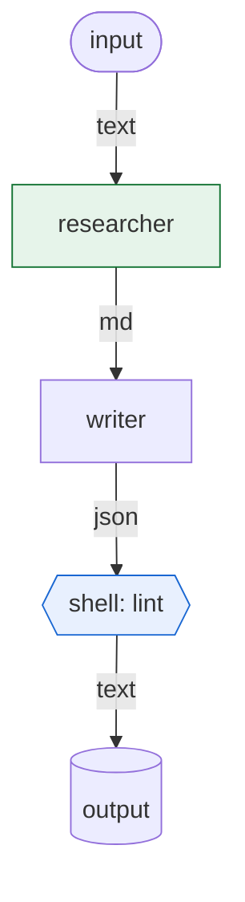

# dsh-xl-build · 子智能体统筹与工作流编排插件设计计划（草稿 v1）

- 日期：2026-11-10
- 状态：待评审
- 目标读者：实现者 / 评审者 / 前端负责人
- 交付形态：`scratch-plugin/dsh-xl-build/` 独立第三方插件包，以 `cordis.patch.yml` 挂载，不修改 `packages/`
- 参考先例：`scratch-plugin/dsh-agent-multi`（图引擎 + 运行看板）、`scratch-plugin/dsh-node-flow`（节点/端口/分支高亮）、`scratch-plugin/dsh-quick-invoke`（`/` 命令与 `@` 触发的客户端接法）

---

## 1 一句话目标

在 DSH 里加一个插件：把「子智能体」定义成可热编辑的声明式文件，能从三条入口被调用（模型工具调用、输入端 `@subagent`、输入端 `/workflow` 且可指定当前 agent 参与），并把多智能体协作固化成可保存、可导入导出、可转 mermaid 的工作流拓扑；前端能看到每个节点与每条边的实时运行状态、每个子智能体产出的正文或文件，文件以超链接点开就在侧边栏阅读。

## 2 需求清单

### 2.1 用户原始需求

| # | 需求 |
|---|---|
| R1 | 子智能体以独立文件定义（名字、说明、system prompt、模型/provider、工具与 skill 可用范围、读写权限、上下文上限） |
| R2 | 前端可直接编辑这些定义，改完立即生效，无需重启 |
| R3 | 调用方式一：LLM 通过工具调用（tool call）调度子智能体 |
| R4 | 调用方式二：输入端 `@` 提及子智能体，直接把它作为本次任务的执行者/协作者提交 |
| R5 | 调用方式三：输入端 `/workflow` 命令运行已保存的工作流 |
| R6 | `/workflow` 必须能显式指定「当前 agent」参与工作流的某个节点 |
| R7 | 工作流拓扑可保存成文件（json / py / 任何能表达拓扑的格式），也可从文件导入 |
| R8 | 拓扑能导出为 mermaid，供前端展示与文档使用 |
| R9 | 节点类型：普通子智能体节点、脚本工具节点 |
| R10 | 边类型：普通边（顺序）、循环边、条件跳转边、多路并行边（fan-out / fan-in） |
| R11 | 每条边可指定传内容格式：`str` / `text` / `json` / `md` |
| R12 | 前端显示工作流整体运行状态与每个节点状态 |
| R13 | 前端显示每个子智能体产出：正文内容，或产出的文件列表 |
| R14 | 产出文件以超链接呈现，点击在侧边栏打开 |

### 2.2 主流框架差距补充

| # | 补充项 | 级别 |
|---|---|---|
| G1 | 运行日志即事实来源：模型可见的输入必须能从 session log 重建（仓库硬约束） | P0 |
| G2 | 失败分类与重试（模型错误 / 工具错误 / 传输错误 / 代码 bug） | P0 |
| G3 | 取消与超时沿拓扑传播（父节点取消 → 子激活与脚本子进程一并取消） | P0 |
| G4 | 循环的终止守卫：`maxIters` + 收敛条件，防止无限循环烧 token | P0 |
| G5 | 拓扑静态校验（可达性、悬空边、循环不合法）在运行前失败 | P0 |
| G6 | 断点续跑：从 journal 恢复到最近完成的节点 | P1 |
| G7 | 节点级 HITL（结构化提问） | P1 |
| G8 | 工作流级预算熔断（总时长 / 总步数 / 总 token） | P1 |
| G9 | 单节点 dry-run（mock 上游输出） | P1 |
| G10 | 子工作流节点（复用已保存拓扑） | P1 |
| G11 | 把已保存工作流注册成模型工具（`run_workflow`） | P1 |
| G12 | 定时/事件触发器（复用 DSH `schedule`） | P2 |
| G13 | 把拓扑编译成 PTC 脚本执行 | P2 |
| G14 | 跨 Run 长期记忆：Run 结束蒸馏为有界记忆文档，后续 Run 显式注入（§6.8） | P1 |

### 2.3 明确不做

- 不做可视化拖拽画布编辑器（v1 只做只读拓扑视图 + 文件编辑；拖动布局留 P2）。
- 不解析任意 Python 代码取拓扑：`.py` 只是「用 Python 写 JSON」的 authoring SDK，执行的是它 `emit` 出来的 JSON。
- 不做跨机器分布式调度；并发只在单 host 进程内。
- 不提供「当前 agent 亲自在自己会话里原地执行某个节点」的语义（原因见 §5.4.3）。
- 不做 AgentSpec 级对话记忆（`@`/工具路径的子智能体跨会话记住之前）；长期记忆只覆盖工作流 Run（§6.8）。

### 2.4 已确认决策

| # | 决策 | 说明 |
|---|---|---|
| D1 | 两种调用方式都保留，分工固定 | 注册成子智能体工具 = 模型自决；`@xx` = 用户显式调用。不设 `mention.mode` 开关 |
| D2 | `self` 节点默认语义 = 当前 agent 的子激活 | 同 lineage、独立上下文，不复制父会话历史；不在自己 turn 里原地执行 |
| D3 | mermaid 不进 client bundle | 只做导出与文档渲染；实时拓扑用自绘 SVG |

---

## 3 现状核实（本设计只使用已验证的接口）

| 能力 | 真实符号 | 位置 |
|---|---|---|
| 启动子智能体 | `ctx.subagents.startActivation(spec)`，`spec: SubagentActivationSpec` | `packages/subagent/subagent/src/index.ts:255,269`；`src/types.ts` |
| 激活请求字段 | `provider`、`label`、`childId?`、`request`、`signal`、`delivery: 'parent' \| 'caller'` | `packages/subagent/subagent/src/types.ts` |
| 请求体字段 | `prompt: ContentBlock[]`、`parent: Agent`、`cwd?`、`agentPreset?`、`agentOptions?`、`outputSchema?`、`maxDepth?`（`label`/`signal` 在 spec 层，不在 `request` 里） | 同上（`SubagentStartRequest`） |
| 结果与句柄 | `SubagentActivation { childId, messageId?, result, dispose() }`，`SubagentResult` | `src/types.ts` |
| 客户端 `@` 触发 | `ctx.inputTriggers.registerSource(src: InputTriggerSource)`；`TriggerChar = '/' \| '@'`；`leading \| inline` | `packages/client/ui-input-trigger/src/client/contract.ts:18`、`src/types.ts` |
| 提及序列化 | `ReferenceCodec`（`clipboardText`、`serialize`）+ `onPick` 返回 `PickOutcome` | `packages/client/ui-input-trigger/src/types.ts` |
| `/` 命令（host） | `ctx.commands.register(definition)`，`handler({ agent, rawInput })` | `packages/interaction/commands/src/index.ts:277,285` |
| `/` 命令（client） | `ui-commands` 注册 `/` 触发源；`ctx.commandUi` / `ctx.connection` / `ctx.sessions` | `packages/client/ui-commands/src/client/service.ts:113` |
| 脚本执行 | `ctx.shell`（`packages/shell/shell/src/index.ts:66`）、`ctx.ptcRuntime`（`packages/ptc-runtime/ptc-runtime/src/index.ts:146`） | 同左 |
| 后台作业 | `ctx.jobs`（`packages/jobs/jobs/src/index.ts:96`） | 同左 |
| 工作流 seam（既有能力） | `ctx.workflowEngine.start(request): WorkflowRun`；`WorkflowStartRequest { script, meta, args?, subagentProvider?, maxTotalAgents?, parent, signal? }`；`WorkflowRun { id, meta, result, cancel, dispose }` | `packages/workflow/workflow/src/index.ts:168`、`src/types.ts`、`src/runtime-types.ts` |
| 工作流访客 helper | `agent(prompt, opts)`、`parallel()`、`pipeline()`、`phase()`、`log()`；`agent()` 只接受 `label` / `phase` / `schema` / `provider` / `model` | `packages/workflow/workflow-ptc/src/runtime.ts:32`、`src/guest-types.ts` |
| 本地子智能体 provider id | `'spawn'`（`workflow-ptc` 的配置默认值，测试同样使用） | `packages/workflow/workflow-ptc/README.md`、`tests/*.spec.ts` |
| 会话事件扩展 | `declare module '@deepseek-ai/dsh-session/types' { interface SessionEventMap { ... } }` | 先例 `scratch-plugin/dsh-agent-multi/src/host/engine/events.ts:166` |
| 运行视图投影 | `ProjectionDefinition { key, stateVersion, stateSchema, init, apply, wire }` | 先例 `scratch-plugin/dsh-agent-multi/src/host/projection.ts:409` |
| 可复用前端面 | `ui-sidebar-right`、`ui-sidebar-files`、`ui-sidebar-documentpreview`、`ui-deliverables`、`ui-workflow-run`、`ui-subagent`、`ui-tool` | `packages/client/*` |

Phase 0 的三点已核实，结论与 `file:line` 证据见 [`impl-plan.md`](impl-plan.md) §1：投影注册走 `ctx.sessionProjections.register(definition)`；提及解析挂在 `agent/pre-step`，其载荷 `messages` 就是本步待进入的消息批，无需自建水位；文件超链接用 `@deepseek-ai/dsh-util-workspace-path` 的 `fileAddressFor(sessionId, cwd, path)`。

---

## 4 术语

- **AgentSpec**：一个子智能体的声明式定义，落盘为一个文件。
- **WorkflowDocument**：工作流的唯一权威表示，JSON，带 `schemaVersion`。
- **Run**：一次工作流执行，拥有独立 session、独立产出目录、独立 journal。
- **Edge payload**：一条边上真正传给下游模型的文本/结构化内容。
- **Self node**：工作流里被标记为「由当前调用者参与」的节点。
- **Memory**：一个工作流的跨 Run 蒸馏记忆——一份有界 Markdown 文档，每次 Run 结束由策展激活全量重写（§6.8）。

---

## 5 子智能体统筹

### 5.1 目录结构

```
scratch-plugin/dsh-xl-build/
  package.json
  cordis.patch.yml
  README.md
  icon.svg
  doc/plan.md                 # 本文
  doc/impl-plan.md            # 施工图
  doc/user-guide.md
  locale/
    en.json
    zh.json
  agents/                     # 默认 AgentSpec 存放目录（可由 Config 改）
    researcher.yml
    memory-curator.yml        # 内置策展 agent：Run 结束后蒸馏长期记忆（§6.8）
  workflows/                  # 默认 WorkflowDocument 存放目录
    review-chain.json
  tools/                      # 构建链，照 dsh-agent-multi，不生成 typert
    clean-build.mjs
    build.mjs
    run-tests.mjs
  vitest.config.mjs
  tsconfig.json
  tsconfig.client.json
  test/                       # 单测与 e2e；快照归 test/snapshots/
  src/
    index.ts                  # host 入口：注册配置、事件、工具、命令、投影
    config.ts                 # Schemastery Config
    events.ts                 # SessionEventMap 合并（xl-build/*）
    projection.ts             # 运行视图
    paths.ts                  # 运行产出目录与文件链接
    agents/
      spec.ts                 # AgentSpec zod schema（单一真源）
      registry.ts             # 加载、监听、热更新、按名解析
      tool.ts                 # 模型工具 xl_agent_run / xl_agent_list
      mention.ts              # 解析与 pre-step 注入；导出纯函数 parseMentions
    workflow/
      domain.ts               # WorkflowDocument zod schema（单一真源）
      validate.ts             # 结构与 DAG 校验
      compile.ts              # 文档 → 执行计划（拓扑分层、端口绑定）
      expr.ts                 # JSONLogic 子集求值器（静态校验与运行时共用同一张运算表）
      engine.ts               # 帧执行器
      envelope.ts             # 边载荷信封的唯一出口
      journal.ts              # journal 写入与续跑
      memory.ts               # 长期记忆：读取注入与策展后处理（§6.8）
      run.ts                  # 启动 Run，命令与 subworkflow 节点共用
      nodes/agent.ts
      nodes/script.ts
      nodes/tool.ts
      nodes/router.ts
      nodes/join.ts
      nodes/loop.ts
      nodes/subworkflow.ts
      nodes/simple.ts         # input / output / note
      mermaid.ts              # toMermaid(doc, view?)
      loaders/json.ts
      loaders/yaml.ts
      loaders/python.ts       # 调用 py SDK 产物，不解析源码
      py/xl_build/__init__.py # authoring SDK：emit JSON
    commands/workflow.ts      # /workflow 命令
    css-modules.d.ts          # declare module '*.module.css'（样式只用 CSS Modules）
    client/
      index.ts                # export { inject } + apply(ctx)
      mount.ts                # 挂载流程：PANEL_ID、原子注入、字典注册、槽位注册、disposer 组合
      locales.ts              # 类型化字典，运行时文案唯一落点（zh/en 键集一致）
      XlBuildIcon.tsx         # 侧边栏行图标（primitives 内置图标）
      mention.ts              # '@' 触发源注册
      panel/WorkflowPanel.tsx
      panel/RunBoard.tsx
      panel/NodeDetail.tsx
      panel/ArtifactList.tsx  # 产出列表与文件打开
      panel/ExportMermaid.tsx
      graph/layout.ts         # 分层布局（移植 dsh-node-flow 思路）
      graph/render.ts         # SVG 渲染 + 状态着色
```

组织原则与 `dsh-agent-multi` 一致：`domain.ts` 里用 zod 定义结构，类型全部由 `z.infer` 推导后 `export type`，不再手写重复接口；host 与 client 各自有独立入口，共享的只有 `domain.ts` 里的纯数据结构。构建链同样照 `dsh-agent-multi`，但**不生成 typert**：本插件不使用 `@Remote`，前端数据通道是投影的 `wire.view`；若日后确有私有 RPC，再单独补 typert，不提前引入。

### 5.2 AgentSpec

```ts
export const AgentSpecSchema = z.object({
  id: z.string().regex(/^[a-z][a-z0-9-]{1,40}$/),
  name: z.string().min(1),
  description: z.string().min(1),
  prompt: z.string().min(1),
  provider: z.string().default('spawn'),
  agentPreset: z.string().optional(),
  model: z.string().optional(),
  reasoningEffort: z.enum(['low', 'medium', 'high']).optional(),
  maxTokens: z.number().int().positive().optional(),
  cwd: z.string().optional(),
  readOnly: z.boolean().default(true),
  timeoutMs: z.number().int().positive().default(600_000),
  outputSchema: z.record(z.string(), z.unknown()).optional(),
})
```

字段映射：`provider`（子激活后端名）是 `startActivation` 的顶层 `provider` 参数；`model` / `reasoningEffort` / `maxTokens` 直接进 `agentOptions`（`AgentOptions` 在 `packages/core` 里只接受 `provider`/`model`/`reasoningEffort`/`maxTokens` 四个键；其中 `provider` 是 LLM 路由，与前者同名不同义，本插件不从 yml 设置它）；`agentPreset`、`cwd`、`prompt`、`outputSchema` 走 `SubagentStartRequest` 的同名字段；`id`/`name`/`description`/`readOnly`/`timeoutMs` 是本插件自己的字段，`description` 只用于模型侧工具枚举与 `@` 菜单。

**AgentSpec 不裁剪子智能体的工具与 persona**：现行 `SubagentStartRequest` 没有工具过滤字段（persona/工具裁剪在 harness 里已迁移到 preset 组合），组合裁剪的唯一入口是 `agentPreset`（独立 preset id，仅 `spawn` 后端支持，fork/外部后端会拒绝该选项；省略时子激活加入父的当前 preset generation）。要「这个 agent 只有某几个工具」，就为它组合一个 preset 并在 yml 里引用其 id。

`readOnly` 不新造权限模型，也不假装能裁剪工具集：`readOnly: true` 只在发给子智能体的 `prompt` 首块前缀一段只读声明（父侧碰不到子激活的 system prompt，这是唯一的注入通道）；真正的权限仍由 DSH 的 approval / permissionPresets 决定——子激活的权限范围在启动时由 delegation 固定，本插件不叠加第二套。`prompt` 以角色块随任务投递：`buildPromptBlocks` 首块 = 只读声明（启用时）+ 角色提示词，次块 = task——仍是用户消息而非 system prompt，身份级 system prompt 只有 agent preset 路径承载（见 `doc/delegation-paths.md` §2）。

### 5.3 注册与生命周期

`registry.ts` 在 host 侧做三件事，全部通过 `ctx.effect()` 注册，插件卸载即整体回滚：

1. 扫描 `Config.agentsDir` 下 `*.yml|*.yaml|*.json`，逐个用 `AgentSpecSchema` 校验；单个文件非法只让该文件进入 `invalid` 状态并在设置页可读地报错，不阻断其他定义。
2. 用 `fs.watch` 监听目录变化，防抖后重载；重载只替换 registry 内的映射，已启动的 Run 继续使用启动时快照（Run 记录 `agentSpec` 的哈希，保证可追溯）。
3. 暴露 `resolveAgent(id): AgentSpec` 与 `listAgents(): AgentSpec[]`，供工具、命令、`@` 菜单三处共用同一个解析入口。

配置项走 Schemastery，全部可由 `cordis.yml` 覆盖，插件内不写死：

```ts
export const Config = Schema.object({
  agentsDir: Schema.string().default('agents'),
  workflowsDir: Schema.string().default('workflows'),
  runsDir: Schema.string().default('.dsh/xl-build/runs'),
  maxConcurrentNodes: Schema.natural().default(4),
  maxConcurrentAgentTools: Schema.natural().default(4),
  runTimeoutMs: Schema.natural().default(1_800_000),
  maxSteps: Schema.natural().default(200),
  scriptTimeoutMs: Schema.natural().default(120_000),
  allowedScriptRuntimes: Schema.array(Schema.union(['shell', 'ptc'])).default(['shell', 'ptc']),
  retryableToolErrors: Schema.array(Schema.string()).default([]),
  wirePreviewBytes: Schema.natural().default(2_048),
  recentRuns: Schema.natural().default(5),
  persistRuns: Schema.boolean().default(true),
  memoryEnabled: Schema.boolean().default(true),
  memoryDir: Schema.string().default('.dsh/xl-build/memory'),
  memoryMaxBytes: Schema.natural().default(16_000),
  memoryCurator: Schema.string().default('memory-curator'),
})
```

`retryableToolErrors` 是白名单而不是开关：空数组表示「工具错误默认不重试」，要重试哪个工具的错误码就显式列出来。`wirePreviewBytes` 是投影下发给前端的单节点预览上限，与边载荷的 `maxBytes`（给模型的）是两回事，不要混用。`maxConcurrentAgentTools` 是经 `xl_agent_run` 同时未结算的激活数上限（异步交付下工具调用不阻塞，闸在启动），与 `maxConcurrentNodes`（图内同时执行的节点数）分属两条路径，不能互相顶替。`memoryEnabled` 是长期记忆总闸（§6.8）：开启即每次 Run 结束多一次策展模型调用的显式成本；`memoryDir`/`memoryMaxBytes`/`memoryCurator` 分别是落盘目录、字节上限与策展 AgentSpec id。

### 5.4 三种调用方式

三条入口最终都汇聚到同一个执行器 `runAgentNode(spec, input, signal, delivery)`，避免「三条路三种行为」；`delivery` 只有两值——对话内路径（模型自决与 `@` 触发，都走 `xl_agent_run`）传 `'parent'`，Run 引擎传 `'caller'`——prompt 组装、选项映射与校验完全共享。

#### 5.4.1 模型工具调用

注册两个工具：`xl_agent_list()` 返回可用 AgentSpec 的 `id/name/description`（不含 prompt，避免上下文泄漏）；`xl_agent_run({ agent, task, cwd? })` 内部：

```ts
// prompt 两块：首块 = 只读声明前缀（§5.2，启用时）+ 角色提示词，次块 = task；agentPreset 仅在 yml 设置时携带；delivery 由调用方传入
const started = await ctx.subagents.startActivation({
  provider: spec.provider,
  label: spec.name,
  request: { prompt: [roleBlock, taskBlock], parent: agent, cwd, agentPreset, agentOptions, outputSchema },
  signal,
  delivery,
})
// 'parent'：立即返回 started.childId，结算后运行时往父会话补完成通知
// 'caller'：await started.result，引擎按 stopReason/structured 调度
```

`delivery` 分两条路。对话内路径（模型自决调用、用户手动 `@` 强制触发，同一个 `xl_agent_run`）用 `'parent'`：子级被接受后工具立即返回 `childId`，不等待执行；结算后运行时往本会话补一条用户角色完成通知（非空结尾文本、`Structured result: <JSON>`、安全诊断），父模型继续干活、空闲时被通知唤醒——与 `task` 工具一致的用户预期，也是 `tool-subagent` 的既有语义。Run 引擎（工作流 agent 节点与 `--self`）用 `'caller'`：调度要程序化拿 `SubagentResult`（`stopReason`/`structured`）自己决定下一步，不往父会话插消息。结构化结果因此有两个消费面：模型读通知文本，引擎读 `result.structured`。

工具描述里写明「何时用子智能体、何时别用」，并照 `tool-subagent` 提示「同一消息并行发起多个、只剩等待时结束 turn 而不是轮询」。`Config.maxConcurrentAgentTools` 统计**经 `xl_agent_run` 启动且未结算的激活数**（异步返回后工具调用不再阻塞，闸在启动），超出按 FIFO 排队新启动而不是拒绝，防止模型扇出 20 个激活打爆配额。`AgentSpec.timeoutMs` 在这条路的执行者：插件保留激活句柄，到点 `dispose()`（结算为 `aborted`，完成通知照常送达），`result` 结算后丢弃句柄，插件卸载时对未结算句柄逐个 `dispose()`；引擎路径的超时仍由节点级 `timeoutMs` 控制（§6.2）。

这条入口的定位是**模型自决**：模型认为该委派就调，不认为就不调，主 agent 自己干完全正常。与之互补的是 `@` 那条路——用户显式指定执行者，见 §5.4.2。两条路不需要互斥开关，因为它们回答的是不同的问题（「谁来决策」）。

#### 5.4.2 输入端 `@subagent`

客户端 `mention.ts` 用已验证的扩展点注册一个引用来源：

```ts
const dispose = ctx.inputTriggers.registerSource({
  trigger: '@',
  name: 'xl-agent',
  order: 20,
  async candidates(session, req) {
    // 客户端面读不到 host registry；候选取自 host 投影快照（§7.1 catalog.agents）
    const agents = catalogAgents(session)
    return agents
      .filter((a) => matches(a, req.query))
      .map((a) => ({
        name: a.id,           // 既是 pick 载荷也是精确匹配键
        label: a.name,        // 展示名；与 name 不同则渲染成「name（id）」别名
        description: a.description,
        icon: AgentIcon,      // ComponentType<IconProps>，不是 'file' 那类字形 token
        section: t('inputTrigger.subagents'),
      }))
  },
  onPick(pick) {
    const ref = pick.candidate.name
    return {
      insert: {
        source: 'xl-agent',
        ref,
        label: pick.candidate.label ?? ref,
        clipboardText: `@${agentLabel(ref)}`,
      },
    }
  },
  codec: {
    clipboardText: (ref) => `@${agentLabel(ref)}`,
    serialize: async (ref, signal) => {
      signal.throwIfAborted()
      return `<xl-agent id="${ref}" />`
    },
  },
})
ctx.effect(() => dispose)
```

`registerSource` 属于**客户端面**：`ctx.inputTriggers` 由 `ClientContext` 发布（`packages/client/ui-input-trigger/src/client/contract.ts`），`candidates(session: ClientSessionContext, req)` 拿的也是客户端 session。所以 `mention.ts` 不能 `import` host 的 registry，`catalogAgents(session)` 只能读当前 session 作用域里的投影快照——先例是 `ui-model-selection/src/client/directory.ts:160` 的 `this.projected.getSnapshot()`。agent 目录必须由 host 写进投影（§7.1 的 `catalog.agents`），客户端再读，这是约定而不是实现自由。Phase 0 要确认该访问器在 `ClientSessionContext` 上的确切名字；若不可用，退化为「host 注册只读命令，客户端经 BFF 查询候选」。

序列化结果是**文本**，因此它天然落到 session log 里，满足「模型可见 ⟺ 已记录」。host 侧 `agents/mention.ts` 挂在 `agent/pre-step`（先例：`goal-round-driver`、`session-reference` 都在此处准备快照），做四件事后 `next()` 放行：

1. **只扫本步增量**：取该步新增的草稿片段，不扫累积历史。token 会随消息常驻 log，若扫历史，同一次提及在后续每一步都会重新命中并重复注入指令。
2. **只认规范 token，并同时接受手输**：拼装器产出 `<xl-agent id="x" />`（`id` 与 `/>` 之间有一个空格），这是唯一规范形式；识别用宽松正则 `<\s*xl-agent\s+id="([^"]+)"\s*\/>`，因为模型重述或用户手改可能丢空格。用户手输的 `@name` 也要解析。因为 `candidates.name` 是 id 而 `clipboardText` 是 `@label`，解析必须按 id 与 label 双向匹配；匹配不到时写 `xl-build/mention-unresolved` 事件并保留原文，不静默丢弃。
3. **由 host 切出 `task` 字面量**：每个提及消费「从该提及结尾到下一个提及开头（或草稿结尾）」这段文本，切成字符串写进事件。定向块里直接给出这段字面量，不让模型自己判断边界——多提及、句中提及、提及后无文本这三种情况，交给模型切分必然出错。
4. **按提及出现位置去重后写 `xl-build/mention-resolved`**：记录 id、解析到的 `name/description`、消费的草稿区间、`task` 字面量。去重键是 `(messageId, segmentIndex)`，不是 `(stepIndex, token)`：用 token 当键会把同一步内对同一 agent 的两次提及（各带不同 `task`）折叠成一次而丢任务；用 `stepIndex` 当键则挡不住同一条消息在多个步骤被重复呈现时的重复注入。同一 token 出现多次时每次都算独立 segment，按出现顺序编号。

注入的定向块因此是确定性的：`agent=<id>`、`task="<字面量>"`，以及「本步第一个动作必须是调用 `xl_agent_run`」。多提及按出现顺序编号成多组指令，不合并成一段。

只有「解析 + 定向」发生在本步，真正的执行永远走工具，因此不存在「提及静默触发副作用」的问题，也让用户能在时间线上看见发生了什么。

`@` 的定位是**用户显式调用**，所以它恒为强指令，不提供 `mention.mode` 开关。

两个入口的分工写死在这里，避免日后被合并成一个：**注册工具 = 模型自决，`@` = 用户显式指定执行者。** 前者允许模型判断「这事不值得开子智能体」；后者表达用户的明确意图，模型没有拒绝的余地，只能按指定 agent 执行。

代价也要写明：指令本身是提示而非硬约束，模型仍可能不遵守。它不遵守时的表现是主 agent 自己干活，任务不会静默丢失，而且日志里能直接看出 `xl_agent_run` 没被调用——这是可观测的失败，不是无声的错误。

#### 5.4.3 输入端 `/workflow`（含当前 agent）

host 侧 `commands/workflow.ts` 用已验证的命令服务注册：

```ts
ctx.commands.register({
  name: 'workflow',
  description: '运行/校验/导出已保存的工作流',
  usage: '/workflow run <id> [--input k=v] [--self <nodeId>] | list | validate <file> | export <id> --mermaid',
  handler: async ({ agent, rawInput }) => { /* 解析 → 交给引擎 */ },
})
```

命令 `handler` 拿到的是活的 `Agent`，这就是「含当前 agent」的落点。语义上分两层：

- **默认**：Run 在独立 session 里执行，`self` 节点的 `parent` 指向命令发起者，结果汇总成一条 follow-up 消息回到当前会话。当前会话保持干净，时间线上只有「工作流跑完了 + 摘要 + 产出链接」。
- **`--self <nodeId>`**：显式把某个节点标成 `self`，由当前 agent 的**子激活**执行该节点（同 lineage、独立会话），`delivery: 'caller'` 把结果交回 Run。

必须写明的差异：`packages/subagent` 的 `SubagentStartRequest` 只有 `prompt`、`parent`、`cwd?`、`agentPreset?`、`agentOptions?`、`outputSchema?`、`maxDepth?`（`prompt`/`parent` 必填），**没有「复制父会话历史」的能力**（`agentPreset` 省略时加入的是父的 preset generation，不是对话历史）。所以「让当前 agent 亲自执行该节点」在 v1 落地为「当前 agent 的子激活执行该节点」：同一套 prompt/工具/权限，但记忆为空，需要靠 `self` 节点配置里的 `context` 字段显式注入上下文（`{ lastMessages: n }` / `{ from: 'run-input' }` / `{ from: 'memory' }` 三选一，与 §6.2 的取值定义是同一套）。这一点在 `doc/user-guide.md` 与工具描述里都要重复说明，否则用户会误以为它会记得自己刚才说的话。

为什么不在自己的 turn 里原地跑节点：命令处理发生在模型 turn 之外，要等当前会话自己的 `turn/end` 就必须在自己正在被调用的调用栈里等自己，形成自锁；还要处理用户在同一会话继续输入的竞态。v1 明确不做，P1 若要做必须配 session 锁与 `turn/end` 栅栏，并单独评审。

### 5.5 事件

事件名统一 `xl-build/` 前缀，全部带 `version: 1` 的载荷对象，并按 `dsh-agent-multi` 的方式做声明合并：

| 事件 | 载荷（要点） |
|---|---|
| `xl-build/mention-resolved` | `agentIds[]`、`resolvedNames[]`、`messageId`、`stepIndex`、`segments[]`（每个 segment 带 `segmentIndex`、消费的草稿区间与 `task` 字面量） |
| `xl-build/mention-unresolved` | `token`、`messageId`、`stepIndex`、`segmentIndex?`、`reason`（未知名 / 歧义 label / 已失效定义） |
| `xl-build/run-start` | `runId`、`workflowId`、`workflowHash`、`selfNodeId?`、`inputs` |
| `xl-build/node-start` | `runId`、`nodeId`、`kind`、`attempt`、`frame`、`startedAt`、`inputsDigest` |
| `xl-build/node-input` | `runId`、`nodeId`、`edges: { edgeId, from, format, bytes }[]`、`text` |
| `xl-build/node-delta` | `runId`、`nodeId`、`text`（子智能体流式输出） |
| `xl-build/edge-transfer` | `runId`、`edgeId`、`from`、`to`、`kind`、`format`、`bytes` |
| `xl-build/node-end` | `runId`、`nodeId`、`status`、`durationMs`、`artifacts[]`、`outputDigest` |
| `xl-build/node-error` | `runId`、`nodeId`、`class`、`message`、`attempt` |
| `xl-build/run-end` | `runId`、`outcome`、`totalDurationMs`、`artifacts[]` |
| `xl-build/memory-updated` | `runId`、`workflowId`、`outcome: 'updated' \| 'kept'`、`bytes?`、`reason?`（策展失败/超限/超时保留旧记忆） |

`edge-transfer` 是给前端画边用的独立事件：它带 `bytes` 与 `format`，前端就能在边上显示「md · 1.2KB」，并且在载荷超限被裁剪时明确显示裁剪标记而不是静默丢内容。

---

## 6 工作流

### 6.1 唯一权威表示

```ts
export const WorkflowDocumentSchema = z.object({
  schemaVersion: z.literal(1),
  id: z.string().regex(/^[a-z][a-z0-9-]{1,60}$/),
  name: z.string().min(1),
  description: z.string().optional(),
  entry: z.string(),
  defaults: z.object({
    nodeTimeoutMs: z.number().int().positive().default(600_000),
    maxAttempts: z.number().int().min(1).default(2),
    edgeMaxBytes: z.number().int().positive().default(64_000),
  }).default({}),
  nodes: z.array(WorkflowNodeSchema).min(1),
  edges: z.array(WorkflowEdgeSchema),
  outputs: z.record(z.string(), z.string()).default({}),
})
```

所有入口（json 文件、yaml 文件、Python SDK 产物、模型生成、前端导出）最终都产出这个结构；不存在第二种运行时表示，mermaid 与前端图都是它的投影。

### 6.2 节点

| kind | 作用 | 关键字段 |
|---|---|---|
| `input` | 运行入口参数声明 | `params: { name, required, default }[]` |
| `agent` | 子智能体节点 | `agent`（AgentSpec id）、`task`（模板）、`context?`、`self?`、`outputSchema?`、`maxAttempts?` |
| `script` | 脚本/工具进程节点 | `runtime: 'shell' \| 'ptc'`、`command` / `script`、`args`、`stdin: 'edges' \| 'none'`、`timeoutMs?` |
| `tool` | 直接调用某个 host 工具（确定性步骤） | `tool`、`args`（模板） |
| `router` | 条件跳转 | `branches: { when, to }[]`、`else: string`（节点 id） |
| `join` | 并行汇合 | `strategy: 'all' \| 'any' \| 'quorum'`、`quorum?`、`failFast` |
| `loop` | 循环容器 | `body`（body 入口节点 id）、`until: { expr }`、`maxIters`、`onMaxIters?: 'fail' \| 'continue' \| 'stop'`（默认 `fail`）、`carry?: string[]`（loop-back 边 id 列表）、`emit?`（收敛帧的输出边 id，缺省取 loop 节点出边） |
| `subworkflow` | 子工作流 | `workflow`（id）、`inputs`（映射） |
| `output` | 运行出口 | `value`（模板） |
| `note` | 注释，不执行 | `text` |

所有节点共用三个基础字段：`id`、`timeoutMs?`、`maxAttempts?`。其余字段只属于具体 kind，跨 kind 混用（例如 `self` 出现在 `script` 上）在 schema 解析阶段即失败。实现上 `WorkflowNodeSchema` 是 `z.discriminatedUnion('kind', ...)`，各成员 `extend` 同一份基础 schema；文档级 `defaults.nodeTimeoutMs` / `defaults.maxAttempts` 只在这两个字段缺省时兜底。

`agent` 节点的 `task` 是模板，可用 `{{input.xxx}}`、`{{nodes.xxx.output}}`、`{{edges.edgeId}}`、`{{memory}}` 四种引用（`{{memory}}` 是该工作流的长期记忆文本，禁用或无记忆文件时解析为空串，V13 白名单恒放行——工作流要能跨部署共享）；模板求值只做字符串替换与 JSON 取值，不执行表达式，杜绝注入。

`context` 是 `agent` 节点的必答项，不是可选项里的装饰：`SubagentStartRequest` 没有复制父会话历史的能力，子激活的记忆天然为空。四种取值——`'none'`（默认，只给 `task`）、`{ lastMessages: n }`（把当前会话最近 n 条消息压成摘要放进 prompt）、`{ from: 'run-input' }`（注入本次 Run 的输入）、`{ from: 'memory' }`（注入该工作流的长期记忆，与 `{{memory}}` 模板引用同源，见 §6.8）。`self` 节点必须显式选择非 `'none'` 的取值，否则「当前 agent 参与」会退化成「一个不认识上下文的陌生人执行」，这正是 §5.4.3 要防的误解。

`self` 是 `agent` 节点上的布尔字段（`self?: boolean`，默认 `false`；出现在其它 kind 上即校验失败）。它只决定该节点子激活的 `parent` 取谁，不改变执行方式——`/workflow run --self <nodeId>` 就是把对应节点置为 `true`。`context` 的四种取值由 §6.4 V16 校验：`{ lastMessages: n }` 要求 `n` 是 ≥1 的整数，`self: true` 的节点不得取 `'none'`。

`router` 的 `when`、`loop.until` 的 `expr`、边的 `condition` 三者共用同一个求值入口 `evalExpr(expr, frame)`，只是挂在不同位置。入口唯一，才不会出现三套语义各自漂移。

`router` 与 `loop.until` 的 `when` / `expr` 使用 JSONLogic 子集（`==`、`!=`、`>`、`<`、`and`、`or`、`!`、`in`、`var`），不使用 `eval` / `new Function`。这样表达式可以静态校验、可以被非 JS 前端复用，也能安全地把模型生成的条件挡在沙箱里。

实现放在 `workflow/expr.ts`，自建求值器约 80 行，不引第三方库：运算符是一张闭集表，静态校验与运行时求值复用同一张表；现成的 json-logic 库没有类型，接进来会把 `any` 漏进编译期，与「不使用 `as any`」冲突。这是「优先维护依赖」规则的例外，理由写在文件头注释里。

### 6.3 边

```ts
export const WorkflowEdgeSchema = z.object({
  id: z.string(),
  from: z.string(),
  to: z.string(),
  kind: z.enum(['flow', 'branch', 'fan-out', 'fan-in', 'loop-back', 'error']),
  format: z.enum(['str', 'text', 'md', 'json']).default('text'),
  label: z.string().optional(),
  select: z.string().optional(),   // JSONPath 子集，从上游结构化输出取子字段
  template: z.string().optional(), // 覆盖默认载荷的模板
  condition: z.string().optional(),// branch 边专用，JSONLogic
  maxBytes: z.number().int().positive().optional(),
})
```

| format | 语义 | 注入下游的形式 |
|---|---|---|
| `str` | 压成单行：去掉行首行尾空白，把换行折叠为一个空格 | 纯文本块 |
| `text` | 原样文本，保留换行，不做任何 markdown 解释 | 纯文本块 |
| `md` | 视为 markdown，下游 prompt 里注明「以下内容是 markdown」 | 文本块 + 语言标记 |
| `json` | 结构化值，序列化为缩进 JSON | 文本块 + `application/json` 标记；若上游声明了 `outputSchema`，传输前按其校验，失败即该边传输失败 |

四类边（普通 / 循环 / 条件 / 并行）与 `kind` 的对应：

- 普通顺序：`kind: 'flow'`。
- 条件跳转：从 `router` 出发的多条 `kind: 'branch'` 边，每条带 `condition`，`else` 目标的那条不带 `condition`。
- 多路并行：同一节点出多条 `kind: 'fan-out'` 边表示同时启动；`join` 节点的多条入边写 `kind: 'fan-in'`。
- 循环：`kind: 'loop-back'`，从 loop body 尾部指向所属 `loop` 节点。**循环不以回边形式存在于可执行图上**：编译时先删掉所有 `loop-back` 边，剩余图必须是 DAG；回边只作为 loop 节点的 `body` 边界信息存在。

边上真正传的载荷统一包一层信封，下游模型与日志看到的是同一种文本：

```
[edge research -> writer | format=md | 1.2KB]
<content>
[/edge]
```

信封由一处函数生成，日志（`node-input`）与模型实际输入使用同一字符串，保证「模型看到的」与「日志记的」逐字一致。

### 6.4 校验规则

`validate.ts` 在运行前全部跑完，任一条失败即拒绝启动并给出节点/边 id（不静默跳过）：

| # | 规则 |
|---|---|
| V1 | `id` 全局唯一且匹配命名正则；`nodes` 与 `edges` 不允许重复 id |
| V2 | `entry` 存在，且没有非 `loop-back` 入边 |
| V3 | 每条边的 `from` / `to` 都存在；自环一律非法（自环要用 loop 节点表达） |
| V4 | 非 `output` / `note` 节点至少有 1 条出边；`output` 与 `note` 没有出边；`note` 没有入边 |
| V5 | 所有节点从 `entry` 可达（不可达的孤立节点报错，而不是静默不执行） |
| V6 | `router` 的出边必须全是 `branch`，且恰有一条无 `condition`（else） |
| V7 | `join` 的入边必须全是 `fan-in`，出边必须全是 `flow` |
| V8 | 删除全部 `loop-back` 边后，剩余图无环（Kahn 拓扑排序检测） |
| V9 | 每条 `loop-back` 的终点必须是 `loop` 节点，起点必须在该 `loop` 节点的 `body` 可达集合内 |
| V10 | `loop` 节点的 `body` 必须存在，且 `body` 不可为 `loop` 自身 |
| V11 | `subworkflow` 引用的工作流存在，且引用图无环 |
| V12 | `format: 'json'` 的上游节点必须声明 `outputSchema`，否则编译期报错 |
| V13 | 模板里引用的 `input` / `nodes` / `edges` 键必须存在 |
| V14 | 规模上限：`nodes ≤ 200`、`edges ≤ 800`、单次 fan-out 出度 ≤ 32 |
| V15 | body 子图闭合：除 `loop-back` 外，任何边不得跨越 loop 边界（起点在 body 内、终点在 body 外，或反之） |
| V16 | `context` 取值校验：`{ from: 'run-input' }` 要求文档存在 `input` 节点；`{ lastMessages: n }` 要求 `n` 为 ≥1 的整数；`self: true` 的节点不得取 `'none'`；`self` 只允许出现在 `agent` 节点上 |
| V17 | `error` 边至多一条，且其 `to` 不得是 `loop` / `join` 节点（失败分支不参与汇合与轮次语义） |

V8 与 V15 必须一起读：V8 保证「把回边摘掉后是个 DAG」，V15 保证「每个 loop 的 body 是一个自洽子图」。缺 V15 时，body 里的 `router` 可以跳到一个 body 外的节点，编译期无法判断该节点属于哪一轮执行。

### 6.5 执行器

**先说结论：本插件自带图执行器，而不是把拓扑编译成 `ctx.workflowEngine` 的脚本。** 这不是重复造引擎的偏好，而是三条硬约束逼出来的；理由必须写在文档里，否则评审第一轮就会问「为什么不用仓库里的 workflow」。

仓库已有 workflow 子系统：`ctx.workflowEngine`（`packages/workflow/workflow/src/types.ts` + `runtime-types.ts`）、PTC 实现 `dsh-workflow-ptc`、消费者 `dsh-tool-workflow`。它的模型是「一段模型写的脚本 + `agent()` / `parallel()` / `pipeline()` / `phase()` / `log()` 五个 helper」，`WorkflowStartRequest` 只带 `script`/`meta`/`args`/`subagentProvider`/`maxTotalAgents`/`parent`/`signal`。

| 本设计需要 | 经由 `ctx.workflowEngine` | 结论 |
|---|---|---|
| 脚本/工具节点（R9） | 访客只暴露 5 个 helper，没有 `ctx.shell` / `ctx.tools` 绑定，脚本无法在访客内执行 | 不满足 |
| 子智能体在父会话可见（R13） | workflow 拉的子进程「不加进父 subagent catalog，也不向父模型发结算通知」（`workflow-ptc` README） | 与需求相反 |
| 节点级状态（R12） | 只有 `phase`/`log`/`agent-start`/`agent-end` 四类进度，非 agent 节点不可见 | 不满足 |
| 边级载荷格式（R11） | 边不存在，`agent()` 之间只能靠脚本变量传值 | 不满足 |
| 并行与 join 语义（R10） | `parallel()` 是「全部跑完返回数组」，没有 quorum / any | 需自建 |
| 循环收敛（G4） | 脚本自己写 `for`，引擎不知道轮次 | 需自建 |

反过来，直接 `ctx.subagents.startActivation` 恰好给出我们需要的东西：`delivery: 'caller'` 只把结果交回调用方、不发消息给父模型，但本地子激活**仍然进入父 catalog**——前端因此能列出每个节点的子智能体，而父模型的上下文不会被污染。

所以 `engine.ts` 自己实现，但不另起一套词汇：事件载荷复用 `workflow` 子系统的约定（`WorkflowAgentInfo` 的形状、`workflow/end` 不带结果值、观察者失败被吞掉且记日志），错误分类与 journal 做法沿用 `dsh-agent-multi`，避免出现第三种风格。

与 `ctx.workflowEngine` 的关系说清楚：同一 context 里只能有一个 engine，我们**不注册** `ctx.workflowEngine`，只在 G13 阶段提供单向导出——把「纯 agent 节点、无脚本、无边格式」的拓扑编译成 PTC 脚本交给现有引擎跑。这样两条路不会互相顶替。

执行循环：

1. `compile(doc)` 产出 `Plan`：节点表、入边表、拓扑层、每个 loop 的 body 节点集合。
2. 执行状态按**帧**组织，不是 Run 级全局：`frame = { id, loopId?, iteration }`。顶层 Run 是根帧；每个 loop 的每一轮迭代开一个新帧，帧内 `states`（`type NodeStatus = 'running' | 'completed' | 'failed' | 'skipped' | 'cancelled'`）与 `edgePayloads` 独立持有，帧结束时只把 `carry` 指定的边载荷交给下一帧。这一条是循环语义能否成立的分界：没有帧，join 会读到上一轮遗留的入边结果。
3. 帧内选出「所有入边已完成且满足触发条件」的 `pending` 节点；`fan-out` 产生的分支按 `maxConcurrentNodes` 并行；`join` 节点在策略满足（`all` / `any` / `quorum(n)`）后触发。join 判定只看本帧的入边。
4. 节点执行：解析入边载荷 → 渲染模板 → 按 kind 调用对应实现 → 立刻写 `node-end` → 按出边 `format`/`select`/`maxBytes` 生成载荷 → 写 `edge-transfer`。
5. 失败：按错误分类决定是否重试（模型/传输可重试，工具错误按 `Config.retryableToolErrors` 白名单重试，代码 bug 不重试），写 `node-error`；重试耗尽则进入 `failed`，`error` 边若存在则沿它继续，否则终止 Run。
6. `loop` 节点：对 body 子图逐轮开帧执行；每轮结束以该帧为求值上下文跑 `until`；达到 `maxIters` 仍未收敛时按 `onMaxIters`（默认 `fail`）处理。循环的输入输出端口定义在 `compile` 阶段完成，见下方端口规则。
7. 取消：Run 级 `AbortSignal` 传到每个子激活与脚本子进程；取消后不再启动新节点，已在跑的等待其 `dispose()` / 进程退出再结束。
8. 预算：`maxSteps` 计「已执行节点数」（跨帧累计），`runTimeoutMs` 计墙钟；任一超限即终止并标记 `outcome: 'budget-exceeded'`。

循环的端口与载荷规则（缺一条就会在编译期留下类型洞）：

- `loop` 节点在编译后的 `Plan` 里有一个逻辑入口端口 `in`，其类型是该 loop 节点全部入边载荷的并集。多条入边时必须同名或经边的 `select` 收敛到同一字段；收敛不了就校验失败，因为那样首轮载荷不唯一。
- 第 1 轮：body 入口节点接收 `in` 的载荷。为此编译期为 body 入口节点补一条**只存在于 `Plan`、不存在于文档**的合成入边 `loop.in → bodyEntry`；因为它不在文档里，V15 的边界闭合检查不受影响，而步 3 的「所有入边已完成」判定对入口节点照常成立。
- 第 N+1 轮：body 入口节点接收 `carry` 所列边的载荷，按数组顺序映射；`carry` 的元素是 **loop-back 边 id**（不是节点 id），其 `to` 必须是该 loop 节点，由 V9 保证。未列入 `carry` 的回边不跨轮传递。
- `loop` 节点自身的输出 = 收敛那一帧里 `emit` 指定边的载荷；`emit` 缺省时取该 loop 节点的第一条出边。`{{nodes.<loopId>.output}}` 取的就是这个值。
- 嵌套 loop 用帧栈实现：内层帧的 `in` 取自外层**当前帧**里该内层 loop 节点的入边载荷，内外两层的 `carry` 互不可见。

断点续跑的边界必须写死，否则会重复副作用：已完成节点一律复用 journal 里的输出，不重放；正在执行的节点（journal 里有 `node-start` 无 `node-end`）标记为 `unknown` 并停止续跑，由人决定重跑还是放弃；未开始节点正常执行。P1 只做到这一步，不承诺「编辑中间层后继续」。

每个 Run 独立目录：`<runsDir>/<runId>/` 下放 `workflow.json`（启动时快照）、`journal.jsonl`、`artifacts/<nodeId>/`。`persistRuns=false` 时只保留内存态 journal，用于调试。

脚本节点只允许 `allowedScriptRuntimes` 里列的 runtime，且强制显式 `timeoutMs`（缺省取 `Config.scriptTimeoutMs`），输出超过 `maxBytes` 时截断并在事件里带 `truncated: true`。

### 6.6 mermaid 映射

`toMermaid(doc, view?)` 是纯函数，输入 `WorkflowDocument` 与可选运行视图，输出字符串。形状固定成一张表，避免每次导出风格漂移：

| kind | mermaid | 示例 |
|---|---|---|
| `input` | stadium | `in1(["input"])` |
| `output` | cylinder | `out1[("output")]` |
| `agent` | rect | `a_research["researcher"]` |
| `subworkflow` | subroutine | `s1[["review-chain"]]` |
| `script` | hexagon | `p1{{"shell: lint"}}` |
| `tool` | asymmetric | `t1>"write_file"]` |
| `router` | rhombus | `r1{"needs-fix?"}` |
| `join` | circle | `j1(("all"))` |
| `loop` | trapezoid | `l1[/"≤5 轮"\]` |
| `note` | 注释 | `%% note: ...` |

边：`flow` → `-->`，`branch` → `-- 条件 -->`，`fan-out`/`fan-in` → `==>`，`loop-back` → `-.->`，`error` → `-.->|error|`；`format` 一律写在标签里：`a_research -->|md| a_writer`。

有 `view` 时追加状态着色，只加 `classDef` 与 `class` 两行，不改结构：



同一 canonical IR 同时驱动 SVG 交互图与 mermaid 文本，靠一组快照测试（同一 doc 的两种输出）锁住语义不漂移。

### 6.7 保存格式

- **权威**：`workflows/<id>.json`（`schemaVersion` 显式，未来可做迁移）。
- **可读别名**：`.yml` 允许作者手写，加载时转成同一结构；导出仍写 JSON。
- **Python**：`py/xl_build` 提供 `Workflow`/`Agent`/`edge` DSL，运行 `python -m xl_build build x.py -o x.json` 产出 JSON。插件只读 JSON，从不解析 Python 源码。这样「用 Python 表达拓扑」这条需求被满足，同时避免在插件里养一个 Python 解析器。
- 导入时比对 `schemaVersion`：低版本走 `migrate()`，高版本直接拒绝并说明原因。

### 6.8 长期记忆（跨 Run 学习）

记忆不是累积的对话历史，而是**一份有界文档的全量重写**：每个 workflow id 对应 `<memoryDir>/<workflowId>.md`（UTF-8 Markdown，上限 `Config.memoryMaxBytes`），每次 Run 结束由一次「策展」激活整体重写。全量重写天然强制蒸馏与剪枝——记忆只会被重新表述，不会无限追加；文件是唯一真源，人可以随时编辑或删除，下一次 Run 以文件为准。

**读路径（Run 启动时）**：`run.ts` 在启动 Run 前读该文件（缺失视为空串），截断到 `memoryMaxBytes` 后存入本次 Run 上下文；`run-start` 载荷记录 `memoryBytes`（审计「这次注入了多少记忆」）。注入完全显式，两个入口与既有机制对称：模板引用 `{{memory}}` 与 `context: { from: 'memory' }`（§6.2）。`Config.memoryEnabled = false` 或文件缺失时两者都解析为空，模板引用不报错——工作流要能跨部署共享。

**写路径（Run 结束后的策展后处理）**：`run-end` 事件与发起会话的 follow-up 摘要发出后，引擎异步启动**一次**策展激活，复用节点执行同一套 `runAgentNode(spec, input, signal, 'caller')`：spec 由 `Config.memoryCurator` 解析（内置 `agents/memory-curator.yml`，其 prompt 即策展指令：蒸馏新知、剪枝过时项、合并重复、保持在上限内、全量输出），`parent` = Run 会话的 agent，输入 = 本次 Run 的摘要 digest（由 `run-end` 与 `node-end`/`node-error` 载荷组装，天然有界）+ 当前记忆全文，`outputSchema` 要求 `{ memory: string }`；插件保留句柄，`timeoutMs` 到点 `dispose()`（同 M1 工具路径的执行方式）。成功且字节 ≤ `memoryMaxBytes` 时原子写盘（临时文件 + rename）；任何失败（超时/拒绝/超限/结构不符）保留旧记忆，`xl-build/memory-updated` 以 `outcome: 'kept'` 记录原因，**绝不影响已结束的 Run 结果**。同一 workflow 并发结束的 Run 在插件内按 workflow id FIFO 串行化；`memoryEnabled = false` 整体跳过。

**边界**：记忆只作用于工作流 Run——`xl_agent_run` 与 `@` 对话路径不读不写；AgentSpec 级对话记忆不做（§2.3）。`memory-updated` 是 `run-end` 之后的 Run 会话事件，投影把它折叠进该 Run 记录（卡片与详情显示「本次注入/更新字节数」），不改变 `run-end` 的终态语义。策展激活消耗一次模型调用，这是 `memoryEnabled` 默认开启的显式成本，README 与 user-guide 必须写明。

---

## 7 前端

### 7.1 数据来源

前端不自己算状态，只消费投影：`projection.ts` 导出 `ProjectionDefinition`（`key: 'xlBuild'`、`stateVersion: 1`、`stateSchema`、`init`、`apply`、`wire.view`），实现方式照抄 `dsh-agent-multi/src/host/projection.ts:409` 的形状。一个 session 里可以同时存在多个 Run，所以投影 state 不是单个 `RunView`，而是以 `runId` 为键的映射，`wire.view` 再把「活跃 Run + 最近 N 个已结束 Run」投影出去；只保留单例会在第二次 `/workflow` 时互相覆盖。client 侧通过 `ctx.connection` 订阅视图：

```ts
interface XlBuildView {
  activeRunId?: string
  runs: Record<RunId, RunView>
  catalog: {
    agents: { id: string, name: string, description: string }[]   // §5.4.2 的 @ 候选来源
    workflows: { id: string, title: string }[]
  }
}

interface RunView {
  runId: string
  workflowId: string
  status: 'running' | 'done' | 'failed' | 'cancelled' | 'budget-exceeded'
  nodes: Record<NodeId, {
    status: NodeStatus
    attempt: number
    startedAt?: number
    durationMs?: number
    outputPreview?: string      // 按 Config.wirePreviewBytes 截断
    artifacts: ArtifactRef[]
    error?: { class: string, message: string }
  }>
  edges: Record<EdgeId, { status: 'idle' | 'transferred' | 'truncated', format: Format, bytes?: number }>
  artifacts: ArtifactRef[]
}
```

`outputPreview` 与 `edge-transfer` 的文本一律按 `Config.wirePreviewBytes` 截断后才进 wire，完整内容留在 journal 与 `node-input` 事件里。不在 wire 上放大文本是硬要求：一个 200 节点的 Run 若每个节点回传完整输出，投影会变成第二个会话日志。

`runs` 只保留活跃 Run 与最近 `Config.recentRuns` 个已结束 Run（默认 5），更早的从 `wire.view` 中剔除，但仍然完整留在磁盘 journal 里。`catalog` 由 host 在目录热更新时写入投影，是客户端 `@` 候选的唯一来源（§5.4.2），客户端不得自行扫描 `agents/` 目录。

`ArtifactRef` 统一为 `{ nodeId, path, kind: 'text' | 'file', bytes?, title }`，前端只认这一个类型，不再区分「正文产出」与「文件产出」两套渲染。

### 7.2 面板

左侧边栏新增一个面板：`sidebar.panellist` 注册图标行（list）、`main` 注册面板本体（keyed），两处共用同一 `PANEL_ID`（照 `dsh-agent-multi/src/client/mount.ts` 的成对注册，行 `order` 与内置区段错开，label 用 thunk）。不用右侧栏 tab 的原因：`sidebar.right.pane.tab` 是 session 作用域（无 Session 时整个右栏无内容），而本面板是跨会话的目录/Run 看板（`/workflow run` 默认在独立 session 执行）；`main` 槽 root 作用域、无 Session 绑定，与该视角匹配。面板内含三块：拓扑视图、节点详情、产出列表。

- 拓扑视图：`graph/layout.ts` 做分层布局（按拓扑层从左到右，loop body 用虚线框包住），`graph/render.ts` 输出 SVG；状态用三种颜色（进行中/成功/失败），边上显示 `format · size`。不做拖拽编辑。
- 节点详情：点击节点，右侧显示它的输入（来自 `node-input` 的文本）、输出预览、重试次数、错误分类、产出列表。
- 产出列表：按节点分组，文件项是可点击链接。

会话时间线上的运行卡片另做：不直接复用 `dsh-client-ui-workflow-run`，那个包只折叠 `workflow/*` 事件；我们按它的「phase 分组 + 成员开始/结束配对 + 中断态」规则折叠自己的 `xl-build/*`，保证两种运行卡片在产品语言上一致。卡片与详情含一行记忆状态：本次注入的 `memoryBytes`，Run 结束后显示 `memory-updated` 的 `updated`/`kept` 与字节数（§6.8）。

### 7.3 文件产出与侧边栏打开

`paths.ts` 负责把节点产出登记成绝对路径，并生成前端可用的链接目标。文件项点击时走现有的侧边栏文件预览能力（`ui-sidebar-documentpreview` / `ui-sidebar-files`），不新造一个阅读器：

- 文本类（`.md`/`.txt`/`.json`/`.log`）在 documentpreview 里渲染。
- 其他类型走 `ui-sidebar-files` 的打开逻辑（交给宿主）。
- 产出登记在 `node-end.artifacts` 里，所以刷新页面后仍可从 projection 重建列表，不依赖前端内存。

这里要防的坑：不要让前端自己拼路径。路径由 host 生成并随事件下发，前端只做 `openArtifact(ref)`；否则一旦工作目录变化，链接就会指向不存在的文件。

### 7.4 mermaid 的取舍

不在 client bundle 里引入 mermaid。理由：mermaid 体积大、需要异步初始化、且它不能表达「节点实时状态下的交互」，而实时视图我们用自绘 SVG 已经能做。

mermaid 只用于导出与文档：host 侧 `toMermaid()` 生成文本，前端提供「复制」与「下载 .mmd」两个动作；P2 若确实需要在应用内查看 mermaid，再在私有 profile bundle 里打包 mermaid，并通过 `ctx.documentPreviews` 注册 `.mmd` 预览器，而不是塞进主 bundle。

---

## 8 里程碑与验收

| 里程碑 | 内容 | 验收 |
|---|---|---|
| M0 | 包骨架、Config、事件与投影、AgentSpec 加载与热更新 | 改一个 yml 后 `xl_agent_list` 立刻反映；非法 yml 有可读报错且不影响其他定义 |
| M1 | 三条调用入口 | 工具调用、`@` 提及、`/workflow list` 均可用；`@` 提及在时间线上能看到 `mention-resolved` 事件 |
| M2 | 编排引擎 + 节点实现 | 顺序 / 条件 / fan-out+join / loop（含 maxIters 终止）四类拓扑各有对应测试；V1–V17 校验各有负例测试 |
| M3 | 前端拓扑与运行看板 | 一个 3 节点 fan-out 工作流跑起来时，节点与边状态实时变化；失败节点显示分类与重试次数 |
| M4 | 产出与文件链接、mermaid 导出、Python SDK | 节点产出可点击打开；`toMermaid` 对固定 doc 输出稳定（快照测试）；`python -m xl_build` 产物能直接跑 |
| M5 | 长期记忆（跨 Run 学习） | 同一工作流跑两次，第二次 Run 的 `{{memory}}` / `context: { from: 'memory' }` 注入含第一次的蒸馏结论；记忆文件 ≤ `memoryMaxBytes`；策展失败不影响 Run 结果 |

每期都要求：`pnpm run typecheck`、`pnpm run lint` 通过；新增的模型可见输入都有对应 session 事件；新增 UI 文案走 locale 字典。

---

## 9 风险与限制

| 风险 | 影响 | 处置 |
|---|---|---|
| 子智能体不能继承父会话历史 | `self` 节点「记得刚才聊的」预期落空 | 显式 `context` 字段注入摘要；user-guide 与工具描述明确说明 |
| 循环 + 模板组合可能放大上下文 | token 爆炸 | `loop.maxIters` 必填、`carry` 白名单、边 `maxBytes`、Run 级 `maxSteps` |
| 表达式求值被注入 | 安全问题 | 只用 JSONLogic 子集，禁用 `eval` / `new Function` |
| 脚本节点逃逸沙箱 | 安全 | 沿用 `ctx.shell` 的权限与 approval，不另开旁路；runtime 白名单 |
| mermaid 与交互图语义漂移 | 文档与实际不符 | 两者都由同一 IR 投影，快照测试双向锁定 |
| 事件类型不被旧 reader 认识 | 旧版本加载新日志异常 | 插件事件全部声明为可忽略、投影内做容错解析（照 `dsh-agent-multi` 的 `parsePersisted` 模式） |
| 与既有 `ctx.workflowEngine` 并存，形成第二套编排语义 | 用户困惑、维护双份生命周期代码 | 不注册 `ctx.workflowEngine`；在 README 与 user-guide 明写分工（脚本式 fan-out 用内置 `workflow` 工具，图式编排用本插件）；G13 只做单向编译导出 |
| `@` 提及随历史重复命中 | 同一次提及被反复注入、重复激活 | 只扫本步增量 + `(messageId, segmentIndex)` 去重；解析失败写 `mention-unresolved` 而非静默 |
| 续跑重放副作用 | agent / 脚本节点被重复执行 | 已完成节点复用 journal 输出不重放；有 `node-start` 无 `node-end` 的节点标 `unknown` 停跑，由人决定 |
| 投影随 Run 数量与输出体积膨胀 | 界面收到第二个会话日志 | `wirePreviewBytes` 截断预览；只投活跃 Run 与最近 N 个已结束 Run |
| 长期记忆被污染或无限增长 | 后续 Run 注入失真/失控 | 全量重写强制蒸馏 + `memoryMaxBytes` 硬上限 + 超限即保留旧记忆 + 文件是唯一真源、人可随时编辑/删除 |

---

## 10 与仓库规范的对应

- **model-visible ⟺ logged**：`@` 提及的序列化文本、边载荷信封、pre-step 注入的定向说明，三者都先写事件再进模型上下文。
- **注册即 effect**：目录监听、工具、命令、触发源、投影全部经 `ctx.effect()` 注册，卸载即回滚。
- **不硬编码可调项**：并发、超时、预算、目录、重试白名单、wire 预览上限全部在 Config 里；代码里只保留协议常量（事件名、`schemaVersion`、运算符表）。
- **依赖取向写明例外**：表达式求值器自建而非引库，理由是运算符闭集 + 类型安全；这类例外必须在文件头注释里给出理由，不能默默自建。
- **类型单一真源**：`zod` 定义 → `z.infer` 导出类型，不手写重复 interface；不使用 `as any` / `as unknown`。
- **不猜 API**：本文引用的每个符号都附了文件位置；实现时若与包内类型不符，以包内类型为准并回来改文档。
- **独立插件边界**：不改 `packages/`；需要的能力若扩展点不足，先在这一层绕过并在 §9 记录，再单独提插件侧需求。
